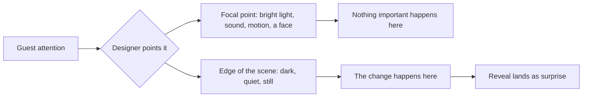

Misdirection is the magician's core skill, and theme parks use it constantly. The principle is simple: people can only attend to one thing at a time, so if you give them something compelling to watch, you can change almost anything else. In a dark ride, a bright animated figure on the right lets a wall slide open on the left. A loud sound cue covers the clunk of a lift. A performer's gaze pulls every eye toward their hand while the other hand does the work. Stage magicians formalised this long before parks existed, and neuroscientists have since confirmed that motion, faces, light and sound are the strongest attention magnets. Misdirection is what makes a trick like [Pepper's Ghost](../show-technology/peppers-ghost.md) survive close viewing, and it shapes queues too: filling a wait with things to look at is really [occupied time](../human-factors/occupied-time.md), the same tool aimed at impatience instead of secrecy. Good [illusions](../show-technology/illusions.md) are mostly good misdirection.

## Explore further
- [Perception](../human-factors/perception.md) — what the eye and brain actually register.
- [Occupied Time](../human-factors/occupied-time.md) — misdirection applied to waiting.
