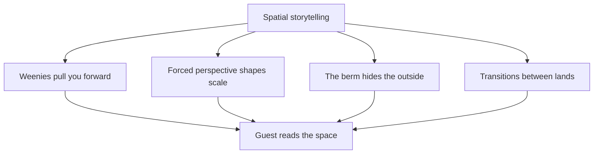

A film tells its story one frame at a time. A theme park cannot do that, because guests choose where to look and where to walk. Spatial storytelling is the answer: the land itself does the narrating. Paths, buildings, planting and sightlines are arranged so that a guest absorbs the story simply by moving through it. A tall landmark, or [weenie](../story-experience/weenies.md), draws people onward. Buildings built with [forced perspective](../story-experience/forced-perspective.md) feel grander than their footprint. An earthen [berm](../story-experience/the-berm.md) keeps the outside world out of view, so the illusion is never broken. Together these tools support the wider [park structure](../masterplanning/park-structure.md) and give each land a beginning, a middle and a payoff, even though no two guests take the same route.

## Explore further
- [Hub and spoke](../masterplanning/hub-and-spoke.md) — the layout that makes weenies work from the centre of the park.
- [Misdirection](../show-technology/misdirection.md) — steering attention once the guest is inside a show.
