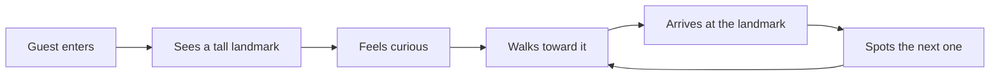

Walt Disney borrowed the word "weenie" from film studios, where a trainer would hold up a hot dog to lead a dog across a set. In a park, a weenie is a tall, striking landmark, such as a castle, mountain or rocket, placed at the end of a long view. Guests see it, feel curious and walk toward it without being told to. This is the simplest tool of [spatial storytelling](../story-experience/spatial-storytelling.md): it moves crowds using desire instead of signs. A good [hub-and-spoke](../masterplanning/hub-and-spoke.md) layout places a weenie at the end of each spoke, so from the centre every direction looks worth exploring. Weenies also shape the whole [park structure](../masterplanning/park-structure.md), because the big icons go in first and the paths are drawn to show them off. Their apparent size is often boosted with [forced perspective](../story-experience/forced-perspective.md).

## Explore further
- [Park structure](../masterplanning/park-structure.md) — where the icons sit in the overall plan.
- [Forced perspective](../story-experience/forced-perspective.md) — how a weenie looks taller than it is.
