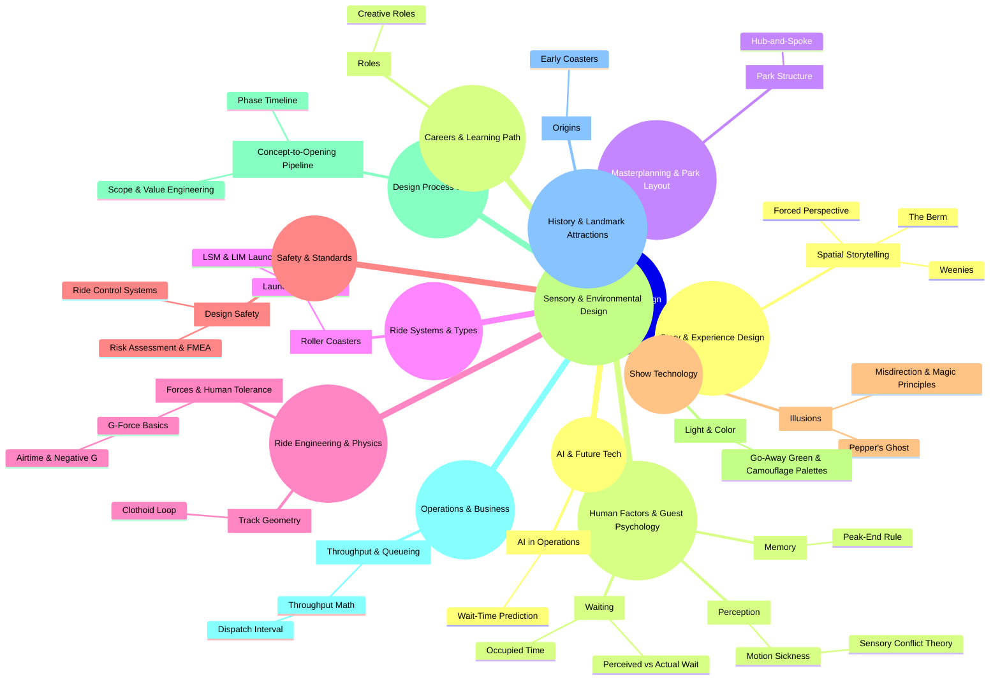

# Knowledge Mindmap — Theme Park & Ride Design (SAMPLE / PLACEHOLDER)

This is placeholder sample content. Depth = abstraction: **Land → Super-concept → Concept → Sub-concept**.

## Full mindmap

## Outline with slugs and levels

Format: `slug` — Title *(level)*. Indent shows hierarchy.

### Story & Experience Design — `story-experience`

- `spatial-storytelling` — Spatial Storytelling *(beginner)*
  - `weenies` — Weenies *(beginner)*
  - `forced-perspective` — Forced Perspective *(beginner)*
  - `the-berm` — The Berm *(beginner)*

### Human Factors & Guest Psychology — `human-factors`

- `memory` — Memory *(beginner)*
  - `peak-end-rule` — Peak-End Rule *(intermediate)*
- `perception` — Perception *(intermediate)*
  - `motion-sickness` — Motion Sickness *(intermediate)*
    - `sensory-conflict-theory` — Sensory Conflict Theory *(intermediate)*
- `waiting` — Waiting *(beginner)*
  - `perceived-vs-actual-wait` — Perceived vs Actual Wait *(beginner)*
  - `occupied-time` — Occupied Time *(beginner)*

### Masterplanning & Park Layout — `masterplanning`

- `park-structure` — Park Structure *(beginner)*
  - `hub-and-spoke` — Hub-and-Spoke *(beginner)*

### Ride Systems & Types — `ride-systems`

- `roller-coasters` — Roller Coasters *(beginner)*
  - `launched-coasters` — Launched Coasters *(beginner)*
    - `lsm-lim-launch` — LSM & LIM Launch *(intermediate)*

### Ride Engineering & Physics — `ride-engineering`

- `forces-and-tolerance` — Forces & Human Tolerance *(intermediate)*
  - `g-force-basics` — G-Force Basics *(beginner)*
    - `airtime-and-negative-g` — Airtime & Negative G *(beginner)*
- `track-geometry` — Track Geometry *(intermediate)*
  - `clothoid-loop` — Clothoid Loop *(intermediate)*

### Safety & Standards — `safety-standards`

- `design-safety` — Design Safety *(advanced)*
  - `risk-assessment` — Risk Assessment & FMEA *(intermediate)*
  - `ride-control-systems` — Ride Control Systems *(intermediate)*

### Show Technology — `show-technology`

- `illusions` — Illusions *(beginner)*
  - `peppers-ghost` — Pepper's Ghost *(beginner)*
  - `misdirection` — Misdirection & Magic Principles *(intermediate)*

### Sensory & Environmental Design — `sensory-environment`

- `light-and-color` — Light & Color *(beginner)*
  - `go-away-green` — Go-Away Green & Camouflage Palettes *(beginner)*

### Design Process & Craft — `design-process`

- `pipeline-overview` — Concept-to-Opening Pipeline *(beginner)*
  - `phase-timeline` — Phase Timeline *(beginner)*
  - `scope-and-value-engineering` — Scope & Value Engineering *(intermediate)*

### Operations & Business — `operations-business`

- `throughput-and-queueing` — Throughput & Queueing *(intermediate)*
  - `throughput-math` — Throughput Math *(beginner)*
    - `dispatch-interval` — Dispatch Interval *(intermediate)*

### History & Landmark Attractions — `history`

- `origins` — Origins *(beginner)*
  - `early-coasters` — Early Coasters *(beginner)*

### AI & Future Tech — `ai-future`

- `ai-in-operations` — AI in Operations *(intermediate)*
  - `wait-time-prediction` — Wait-Time Prediction *(intermediate)*

### Careers & Learning Path — `careers`

- `roles` — Roles *(beginner)*
  - `creative-roles` — Creative Roles *(beginner)*
